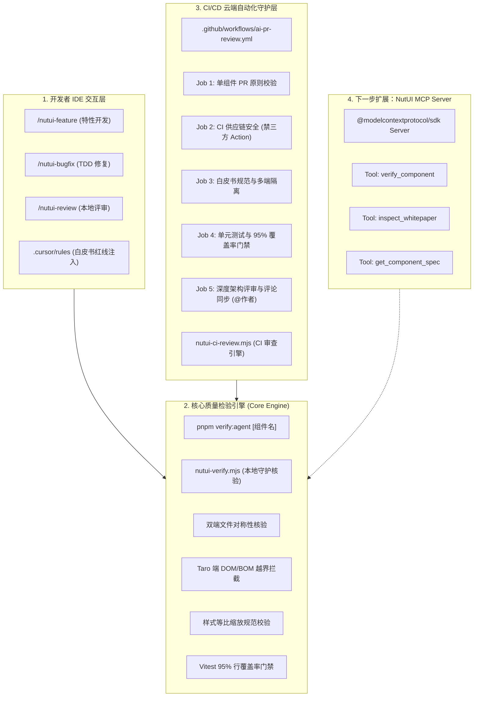

# NutUI-React AI 研发效能与质量守护系统架构全景文档

本文档全面梳理 NutUI-React 在 AI 提效、规范约束、自动化门禁以及 MCP 工具链建设方面的整体架构、已落地的核心实现、代码资产及未来演进规划。

---

## 一、 核心问题回答：MCP 目前建立起来了吗？

### 1. 现状客观说明

- **环境层面**：当前在 IDE 与 Agent 运行环境中，已经挂载并能够使用 Chrome DevTools、JD-SSO、Joyspace 等通用 MCP 插件服务。
- **项目层面**：目前尚未将 NutUI 本地的核心校验能力封装为独立的、通过 stdio/SSE 对外暴露的 **NutUI 原生 MCP Server（如 `mcp-server-nutui`）**。
- **架构决策原因**：
  在前期落地过程中，为了让**所有团队成员和开源贡献者零门槛使用**（无需安装和配置后台 MCP 常驻守护进程），我们优先采用了 **“CLI 驱动 + 规则注入 (Rules) + 工作流指令 (Slash Commands) + CI 原生流水线”** 的轻量高效架构。
- **演进路线**：
  现有核心校验脚本 `scripts/agents/nutui-verify.mjs` 已经具备完善的模块化能力，下一步可极简封装为一个标准的 `@modelcontextprotocol/sdk` 本地服务，暴露 `verify_component`、`inspect_whitepaper`、`run_coverage_gate` 等 MCP 工具。

---

## 二、 整体架构全景图



---

## 三、 已落地的核心实现与代码资产盘点

整个工程共落地了 **5 大支柱**、**15+ 个核心代码/配置文件**，涵盖从“本地开发”到“云端合规拦截”的完整闭环：

### 1. 质量核验核心引擎

| 代码文件 | 核心职责与关键能力 |
| --- | --- |
| `scripts/agents/nutui-verify.mjs` | **本地质量核验基石**：<br>1. **多端对称性检查**：自动核验 `[comp].tsx` 与 `[comp].taro.tsx` 是否成对存在；<br>2. **白皮书环境隔离静态拦截**：正则静态扫描 Taro 源码，禁止裸调 `window/document`（防小程序/SSR 崩溃）；<br>3. **样式缩放规范**：禁止手写 `scale-px(0px)`；<br>4. **测试覆盖率硬拦截**：调用 Vitest 采集覆盖率，**行覆盖率 (Lines) < 95% 强制报错**并输出未覆盖代码区间；<br>5. **TypeScript 编译检查**：确保类型安全。 |
| `scripts/agents/nutui-ci-review.mjs` | **CI/CD 云端审查与报告生成引擎**：<br>1. 支持 `--gate=<single-component\|security\|whitepaper\|coverage\|summary>` 单门禁独立执行；<br>2. 自动比对 Git Diff，精准判定改动组件集合；<br>3. 生成高信噪比 Markdown 报告，自动同步写入 GitHub `$GITHUB_STEP_SUMMARY` 与 PR 评论文件。 |
| `package.json` | 注册统一命令：`pnpm verify:agent [comp]`，开发者与本地 AI 助手均可一键触发自检自愈。 |

---

### 2. IDE 规范与工作流指令 (Slash Commands)

适配 Cursor、Claude Code、Antigravity 等主流 AI 工具：

| 目录与文件 | 适用工具 | 核心功能 |
| --- | --- | --- |
| `.agents/commands/nutui-feature.md`<br>`.claude/commands/nutui-feature.md` | Antigravity / Claude Code | **新特性迭代流**：指导 AI 按“API 设计草案 → 双端对称实现 → Demo & 文档补齐 → 单测用例编写 → 运行 verify:agent 自检”的五步法交付。 |
| `.agents/commands/nutui-bugfix.md`<br>`.claude/commands/nutui-bugfix.md` | Antigravity / Claude Code | **TDD 缺陷修复流**：强制 AI“先写复现单测（转红 Red）→ 根因分析定位 → 应用最小补丁 → 验证转绿 (Green)”，杜绝假修复。 |
| `.agents/commands/nutui-review.md`<br>`.claude/commands/nutui-review.md` | Antigravity / Claude Code | **本地代码评审流**：比对当前 Diff，依据白皮书红线按阻断项 (Blockers)、改进项 (Warnings) 输出高信噪比报告。 |
| `.agents/commands/nutui-plan.md`<br>`.agents/commands/nutui-execute.md`<br>`.agents/commands/nutui-analyze.md` | Antigravity / Claude Code | 架构规划、任务批量执行与深层代码分析专用辅助指令。 |
| `.cursor/rules/nutui-workflow.mdc`<br>`.cursor/rules/component-development.mdc` | Cursor | **IDE 实时规则约束**：为 Cursor Composer / Agent 注入组件目录结构、双端多平台差异及白皮书红线，编写代码时即时生效。 |

---

### 3. GitHub Actions CI/CD 自动化门禁与评论闭环

| 工作流与配置 | 核心机制与突破点 |
| --- | --- |
| `.github/workflows/ai-pr-review.yml` | **多 Job 原生并发架构**：<br>1. **PR Checks 列表直观展现**：拆分为 5 个独立 Job，GitHub PR 页面原生展示 `✅/❌` List 清单，通过或卡住一目了然；<br>2. **秒级并发**：Job 1~3 作为静态扫描在 2 秒内并行完成；<br>3. **CI 供应链安全**：拦截非官方三方 Action，防范供应链投毒；<br>4. **Fork PR 安全兼容**：使用 `pull_request_target` 并配置 `allow-unsafe-pr-checkout: true`，兼顾安全与 Fork PR 评论写入能力；<br>5. **自动 @ 作者与防刷屏更新**：将卡住原因（代码行号、自愈命令）与非统计维度的深度架构评审自动发至 PR 讨论区，二次提交时自动更新原有评论。 |

---

### 4. 探索性 Agent 代码

| 文件路径 | 描述 |
| --- | --- |
| `scripts/agents/issue_resolver.py` | 基于 Google Antigravity SDK 原生封装的 Agent 原型，装配了 Git 命令工具与 Vitest 测试工具，支持 Pydantic 结构化输出修复报告。 |
| `scripts/agents/local_issue_watcher.py` | 本地 Issue 监听守护脚本，可轮询待办 Issue 并触发自动修复尝试。 |

---

## 四、 本地与 CI 执行效果实测回顾

在过去的评审实战中，该套体系已成功完成多项真实验证：

1. **成功阻断违规 PR**：在 PR #3587 中，成功拦截了“单 PR 混改 4 个组件”、“noticebar 裸调 window API 小程序崩溃”以及“rate 覆盖率低于 95%”三大红线。
2. **指导作者完成规范拆分与合并**：
   - 作者根据门禁指导，将 PR 拆解为单一组件 PR：#3594 (pagination) 与 #3595 (rate)；
   - 补齐双端测试与样式收敛，覆盖率达标后顺利并入 `feat_v4.x` 主干！

---

## 五、 下一阶段规划：正式封装 NutUI 原生 MCP Server

为进一步将能力开放给 IDE 内的 AI Agent，我们规划新增 `scripts/mcp-server/nutui-mcp-server.mjs`：

### 拟提供的 MCP Tools：

```typescript
{
  "name": "nutui_verify_component",
  "description": "执行指定组件的完整白皮书规范、双端对称性及 95% 覆盖率校验",
  "parameters": {
    "type": "object",
    "properties": {
      "component": { "type": "string", "description": "组件名称，如 button, rate" }
    },
    "required": ["component"]
  }
}
```

```typescript
{
  "name": "nutui_check_diff",
  "description": "对当前工作区或指定分支的 Git Diff 进行全量白皮书架构红线扫描",
  "parameters": {
    "type": "object",
    "properties": {
      "baseRef": { "type": "string", "description": "对比的基线分支，默认 origin/feat_v4.x" }
    }
  }
}
```

```typescript
{
  "name": "nutui_get_component_spec",
  "description": "获取 NutUI 组件设计白皮书规范及特定组件的代码模式与 API 参考",
  "parameters": {
    "type": "object",
    "properties": {
      "topic": { "type": "string", "description": "主题，如 dual_parity, style_tokens, dom_isolation" }
    }
  }
}
```

通过该 MCP Server，开发者在 Cursor、Claude Desktop 或 Antigravity 中可以直接使用自然语言调用 NutUI 的专属校验与查询工具，形成更深度的交互体验。
